# Line Monitor

I built this because my broadband kept being slower than what I pay for, and a screenshot of one speed test
proves nothing. It runs on a Raspberry Pi 5 wired to my router, tests the line around the clock, and keeps
every result in a form I can hand to my ISP or an ombudsman: the raw records, how they were measured, and a
way to check none of them were changed afterwards.

It's written around a UK Virgin Media Gig1 line (1,130 Mbps advertised, 565 Mbps minimum guaranteed), but the
package figures are settings. Any connection works, and you can keep a history of packages, so an upgrade
doesn't change how older results are judged.

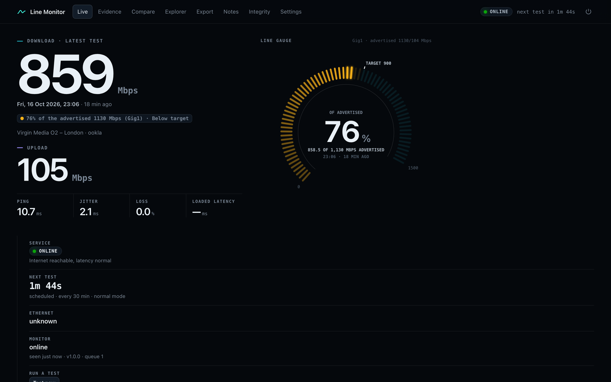

<table>
<tr><td width="50%">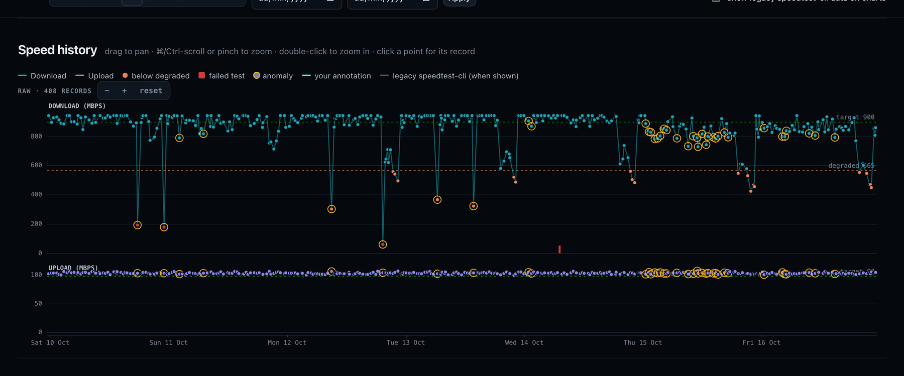<br><b>Speed history</b>: every test, zoomable from a year down to single results, with failures and anomalies marked</td>
<td width="50%">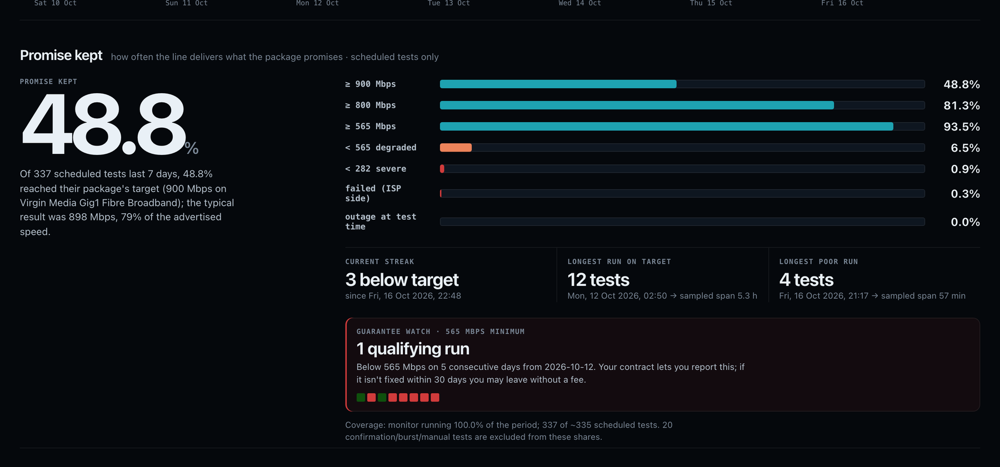<br><b>Promise kept</b>: how often the line actually delivers, plus the guarantee watch</td></tr>
<tr><td>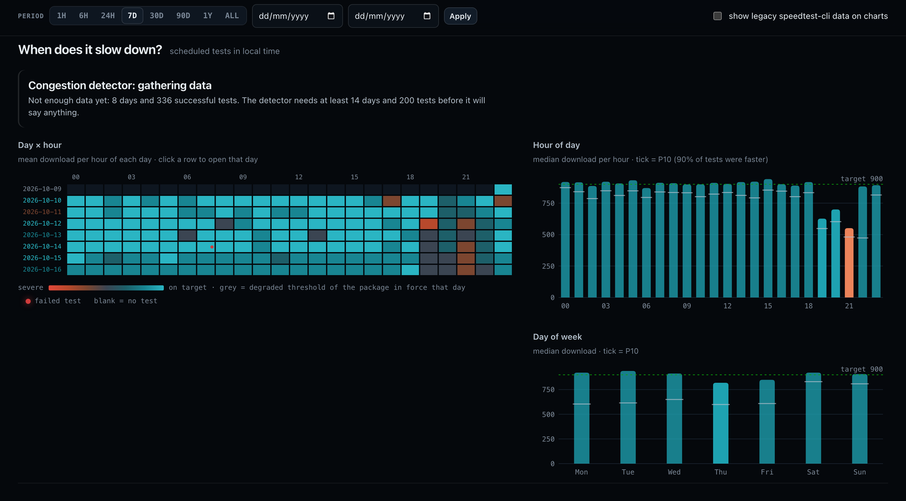<br><b>When does it slow down?</b> Hour by hour, every day, with a congestion check</td>
<td>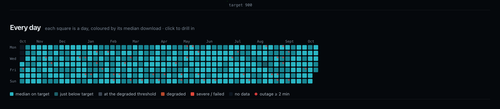<br><b>Every day</b> for a year, coloured by its median download</td></tr>
<tr><td>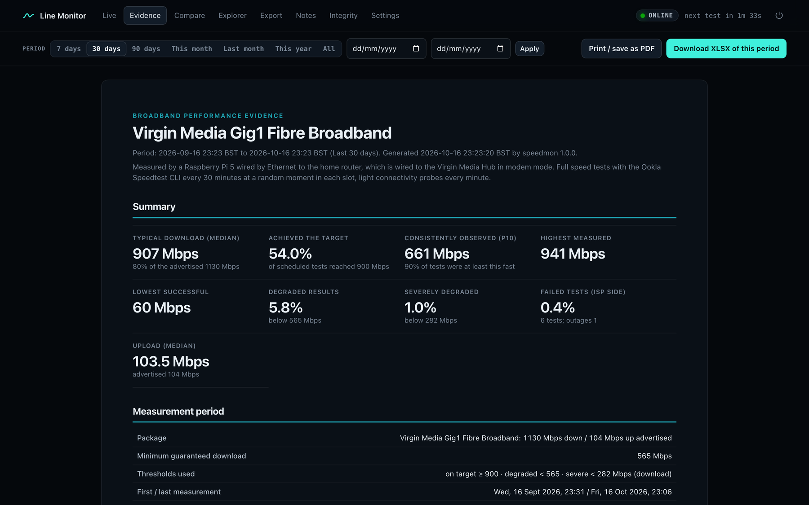<br><b>Evidence</b>: a report for any period that prints or saves as a PDF</td>
<td>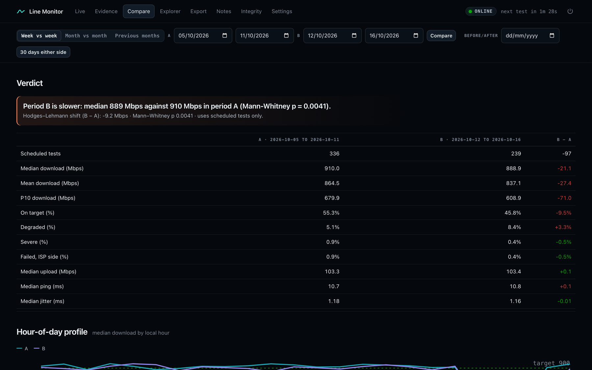<br><b>Compare</b> two periods, with a significance test rather than a guess</td></tr>
<tr><td>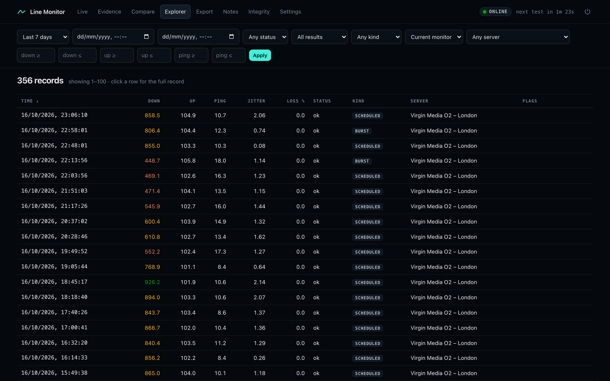<br><b>Explorer</b>: every record, filterable, each one opening its full detail</td>
<td>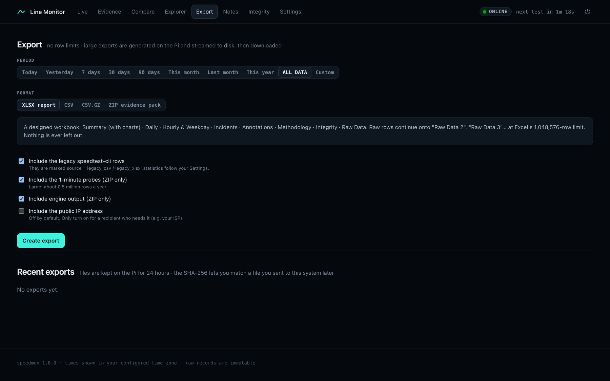<br><b>Export</b> to XLSX, CSV or a ZIP evidence pack, with no row limit</td></tr>
<tr><td>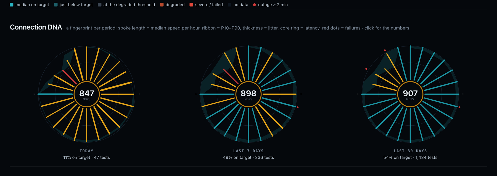<br><b>Connection DNA</b>: a day, a week and a month at a glance</td>
<td>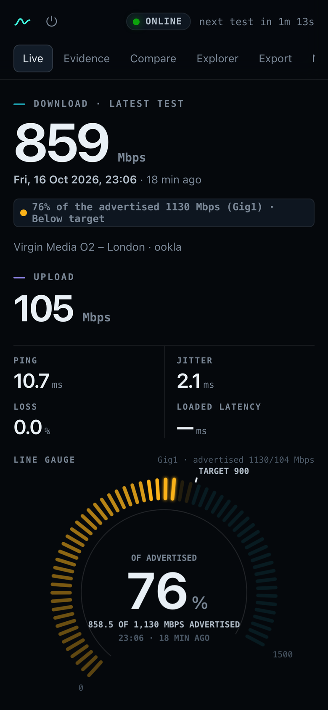<br><b>On a phone</b></td></tr>
</table>

<sub>The screenshots use generated demo data, not a real line.</sub>

## What it does

- **Full speed tests every 30 minutes** with the Ookla Speedtest CLI, at a random moment in each half hour so
  every minute of the hour gets sampled. If Ookla fails, speedtest-go runs instead.
- **A quick check every minute** (ping to the router and two outside hosts, a DNS lookup, an HTTPS request), so
  outages and latency spikes between tests are caught too.
- **More tests when it matters.** A poor result gets two confirmation tests; if they agree, it tests every 10
  minutes for a while. If the line has been bad for hours, it stops piling on extra tests. Hard limits in the
  agent's code mean no setting can make it test every few seconds.
- **Failures are results.** A test that couldn't run is recorded with the reason, never dropped and never
  counted as 0 Mbps. A Pi that was switched off shows as "monitor offline", not as an outage.
- **Statistics that don't overstate.** Percentages and averages use the scheduled tests only, because the extra
  tests deliberately sample the bad moments. Outage lengths are given as ranges, and the congestion check only
  says the evenings are slower when the numbers support it.
- **Guarantee watch.** Under Virgin Media's terms, three days in a row below the minimum guaranteed speed lets
  you report it, and if it isn't fixed in 30 days you can leave without a fee. The dashboard and the XLSX track
  those runs of days for you.
- **Exports with no row limit.** A designed XLSX (summary with charts, daily and hourly tables, incidents,
  methodology, then every raw record, continuing onto a second sheet past Excel's million-row limit), CSV,
  CSV.GZ, or a ZIP evidence pack that includes a small script to re-check every hash.
- **Notes on the timeline**, such as "router replaced" or "engineer visit", so the before and after show up in
  Compare.
- **A fresh start** when a new package goes live: the old database is archived and verified, and a new one
  begins.

## Why the records can be trusted

Every record is hashed when it's made and chained to the one before it, so changing or removing anything
afterwards breaks the chain, and the Integrity page shows it. The database refuses edits to raw records
altogether. Corrections and notes go in a separate layer that's also kept with its history. The agent numbers
every record it sends, so a missing one shows up as a gap. This is tamper evidence, not a certificate, so keep a
copy of the chain head somewhere else from time to time.

## How it fits together

Two small services on the Pi. The agent runs the tests and keeps everything in its own queue first, then sends
it to the backend over a signed connection on the Pi itself. If the backend is down or being updated, nothing
is lost: the queue catches up when it's back. The backend stores the records and serves a private dashboard
behind a pass phrase. Nothing on the home network needs an open port: I reach mine through a Cloudflare tunnel
and nginx.

## Built with

Python 3.11, FastAPI and SQLite on the Pi; plain JavaScript modules and canvas charts in the browser, with no
framework, no build step, nothing loaded from other sites, and no analytics. XlsxWriter for the workbooks. The
Ookla Speedtest CLI and speedtest-go do the actual testing.

## Running it

You'll need a Raspberry Pi (or any Linux box) wired to the router by Ethernet. Wi-Fi can't measure a fast line
properly, and a Pi 5's own gigabit port tops out around 940 Mbps. To measure above that, add a 2.5 GbE USB
adapter with a Realtek RTL8156B chip (UGREEN make one, for example) and cable it to a 2.5G port on the router.
It has to be a USB-A adapter in one of the Pi's blue USB 3 ports, because the Pi 5's USB-C port is for power
only. Also:

- Python 3.11 or newer.
- The Ookla Speedtest CLI (its licence has to be accepted once) and, optionally, speedtest-go.
- systemd and nginx if you want it set up the way mine is.

To try it on your own computer with demo data first:

```bash
python3 -m venv .venv && .venv/bin/pip install -r requirements-dev.txt
.venv/bin/python -m pytest
scripts/dev.sh
```

Then open http://127.0.0.1:8772/speedtest/ and sign in with `correct horse battery staple` (it only works for
the demo database).

The systemd units and nginx snippets I use are in `deploy/`. Setting the pass phrase, backups, restores, updates
and troubleshooting are in [docs/OPERATIONS.md](docs/OPERATIONS.md), and how it all works, including the
database and the hash chain, is in [docs/ARCHITECTURE.md](docs/ARCHITECTURE.md).

## Licence

MIT. See [LICENSE](LICENSE).
